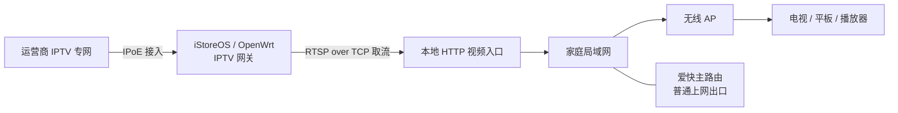

<div align="center">

# 浙江电信 IPTV · 家庭部署实录

**从专网接入，到无线电视。把零散教程，接成一条可以理解和维护的链路。**

`IPoE` · `RTSP over TCP` · `HTTP 单播` · `iStoreOS / OpenWrt` · `爱快`

[看懂架构](ARCHITECTURE.md) · [部署路线](DEPLOYMENT.md) · [故障排查](TROUBLESHOOTING.md) · [参考与致谢](REFERENCES.md)

</div>

---

> **项目状态：实战文档首版 · 2026-10-22**  
> 已在一个家庭环境中落地，并完成无线终端播放验收。本仓库提供脱敏实录、示例参数和只读检查工具；不是一键安装器，也不承诺跨地区直接通用。

## 这个仓库解决什么问题？

普通上网正常，IPTV 却不能直接交给电视上的 VLC、Televizo 等播放器使用：接入认证、专网路由、RTSP 兼容性、无线组播和旁路由配置，可能在不同环节造成失败。

本案例最终采用：**先接入运营商 IPTV 专网，取 RTSP 单播源，再通过本地 HTTP 网关交给家庭终端。** 无线电视收到的是 HTTP 单播视频，而不是直接接收运营商原始组播。



**三个关键分工：** 专网接口负责接入；路由决定从哪里取流；HTTP 网关解决终端播放入口。Wi-Fi 只负责最后一段普通单播传输。

## 一眼看懂最终结果

| 项目 | 本案例结果 | 边界 |
|---|---|---|
| IPTV 接入 | IPoE 专网接入成功 | 参数来自自己的已开通业务，不提供通用认证数据 |
| 上游视频 | RTSP 单播，TCP interleaved | 运营商必须提供可访问的对应服务 |
| 终端入口 | 本地 HTTP 播放列表和视频流 | HTTP 列表可读，不等于所有视频流均可播放 |
| 无线播放 | 已在家庭 Wi-Fi 终端使用 | 无线质量、客户端解码及并发容量仍有影响 |
| 老电视 | Android 5 / 7 终端有实际使用记录 | 不代表所有同版本固件、所有播放器均兼容 |
| 网络共存 | 爱快主路由、iStoreOS/OpenClash 环境共存 | 不公开真实网段、策略备份或代理配置 |

验收范围与尚未验证事项见 [VERIFICATION.md](VERIFICATION.md)。

## 它与已有项目是什么关系？

这是一份**现有技术的部署整合与维护实录**。IPoE 接入研究来自前人的公开文章；RTSP→HTTP 也已有成熟实现，例如 [rtp2httpd](https://github.com/stackia/rtp2httpd)。本仓库的重点是把接入、路由、转发、终端和故障恢复连起来，而非宣称发明新协议。

特别注意：历史上尝试某个工具的组播路径失败，**不等于这个工具不支持 RTSP 单播**。现用自建网关与 rtp2httpd 的性能、兼容性尚未做同环境对照测试。参考来源与贡献边界逐项列在 [REFERENCES.md](REFERENCES.md)。

## 按你的问题开始阅读

| 你想解决的问题 | 阅读入口 |
|---|---|
| 为什么 IPTV 已经能用 Wi-Fi？ | [架构：专网、单播与无线](ARCHITECTURE.md) |
| 准备在自己的网络复现 | [部署：按阶段验证](DEPLOYMENT.md) |
| 有列表，但频道打不开 | [排查：按故障层定位](TROUBLESHOOTING.md) |
| 想知道哪些是实测，哪些是推测 | [验收记录与局限](VERIFICATION.md) |
| 想提交问题或分享经验 | [隐私与反馈说明](PRIVACY.md) |
| 想了解原作者和相关项目 | [参考资料与致谢](REFERENCES.md) |

## 仓库提供与暂未提供

- 提供：原创整理文档、拓扑、占位参数示例、只读检查脚本 `doctor.sh`。
- 暂未提供：现用定制网关、DHCP 接入脚本和一键部署。这些脚本仍需参数化、来源与许可证核对、异常处理测试后再考虑发布。
- 不包含：真实账号、Option 60 内容、设备 MAC、家庭网段、频道源清单、原始抓包、路由器备份或代理订阅。

## 快速检查工具

在自己的 Linux/OpenWrt 网关上，先阅读脚本再运行：

```sh
sh doctor.sh
# 可选：检查你自己指定的本地 HTTP 播放列表（会发送一次 HTTP 请求）
sh doctor.sh --playlist 'http://YOUR_GATEWAY:8554/playlist.m3u'
```

默认只检查命令、接口数量和默认路由数量；不打印实际地址、不改配置、不触发续租、不下载视频。播放列表检查仅输出格式摘要，不输出频道 URL。使用方法见 [部署文档](DEPLOYMENT.md#辅助检查)。

## 后续方向

- [ ] 对定制脚本进行参数化和来源审查。
- [ ] 与 rtp2httpd 的 RTSP 路径进行独立、可回滚的对照测试。
- [ ] 补充多终端并发、长时间播放和重启恢复测试。
- [ ] 收集不同地区、设备的脱敏复现记录。

本仓库原创文档与检查工具采用 [MIT License](LICENSE)。外部文章、项目及其代码保留各自权利和许可证。
